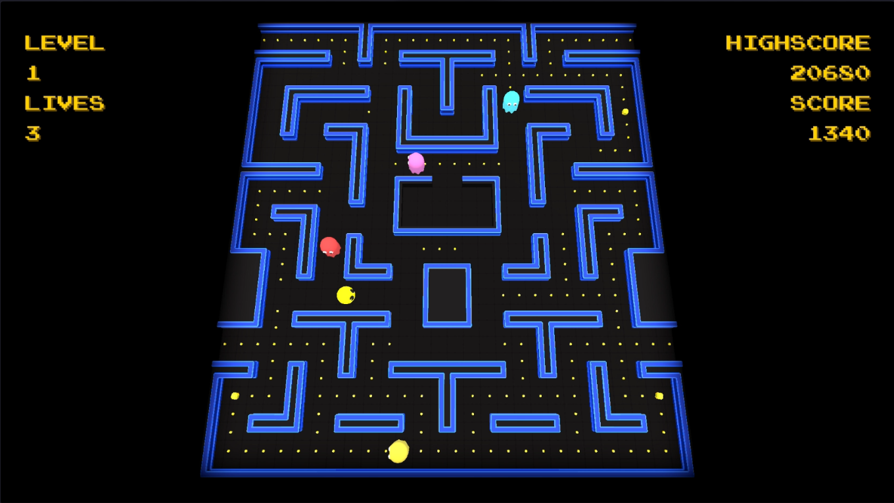
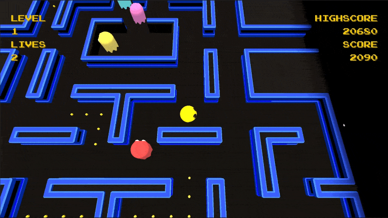
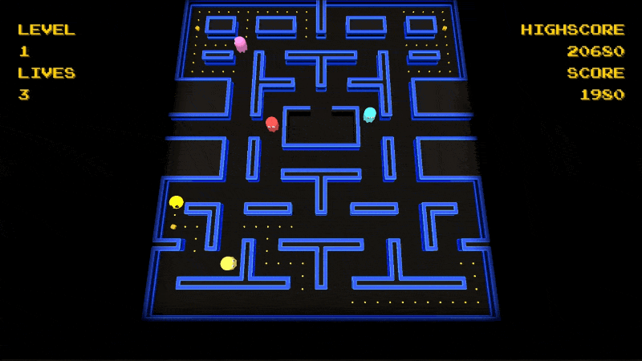
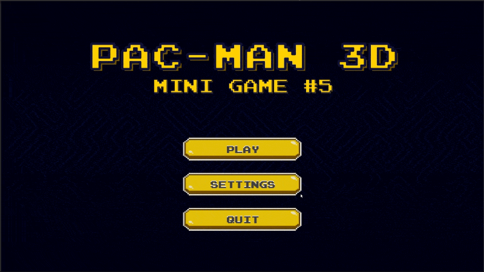

# Pac-Man 3D Clone

A Pac-Man–inspired 3D maze game built in Unity Engine, and the fifth mini game in my game development learning exercises. This project takes the more complete "game-like" structure from Race Rivals and applies it to a classic arcade game. The focus moves to grid-based movement, state-driven enemy AI, and a more modular, data-driven architecture. The core areas I focused on were:

- Node-based grid movement for Pac-Man and the ghosts, with turns queued at maze junctions.
- Ghost AI using a state machine (Chase, Scatter, Frightened, Returning, Waiting), with a unique targeting behaviour for each ghost.
- A rule-tile wall system that automatically picks the right 3D wall mesh and rotation from neighbouring walls.
- A ScriptableObject-based event channel system to decouple gameplay, UI, and audio.
- A Single Entry Point scene setup built from modular ScriptableObject "setup steps".
- 3D models and animations for Pac-Man, the ghosts, pellets, and fruit.
- UI Toolkit menus with Game, Audio, and Control settings, including multiple camera modes.
- More polished feedback through sound effects, dynamic music, camera shake, and post-processing.

## Gameplay
Use WASD/Arrow Keys to guide Pac-Man around the maze, eating every pellet to clear the level. Avoid the four ghosts, or eat a Power Pellet to turn the tables: frightened ghosts can be eaten for bonus points before they return to the pen. Collect bonus fruit for extra points. Each level increases game speed, and you have 4 lives to get as far as possible.

Choose between the classic Pac-Man and Ms. Pac-Man maze layouts, and switch between Fixed, Dynamic, and Follow camera modes.

Clone and build this project in Unity to Play:
### `https://github.com/SaedulH/Mini-Game-5---Pac-Man.git`

## Key Systems
- Ghost AI: Each ghost runs a state machine (Chasing, Scattering, Frightened, Returning, Waiting) and decides its next direction at every maze node by choosing the neighbouring node closest to its target, without being able to reverse. Each ghost targets differently: Blinky chases Pac-Man directly, Pinky aims for tiles ahead of Pac-Man, Inky uses an offset position based on Pac-Man's direction, and Clive chases until close, then retreats to his corner. Pen exit rules (pellet count and timers), corners, and starting directions are set per ghost in GhostConfig ScriptableObjects.

- Node-Based Movement: The maze is a grid of nodes, each storing its valid neighbours. Pac-Man and the ghosts share a common Movement component driven by an IInputHandler interface, so the player input handler and the AI ghost input handler plug into the same system. Teleport nodes handle the side tunnels.

- Wall Rule Tiles: Walls are generated across the maze grid. Each wall checks its 8 surrounding neighbours and whether it sits on the maze boundary, the ghost pen, or the interior, then matches against WallType ScriptableObjects to pick the correct mesh and rotation. This lets new maze layouts be built quickly without placing wall pieces by hand.

- Event Channel System: Gameplay events (score, lives, level state, game/UI state changes, etc.) are broadcast through ScriptableObject event channels with matching listeners. This keeps the managers, HUD, audio, and UI decoupled from each other.

- Scene Management & Level Setup: A Bootstrapper loads a persistent Core Scene following the 'Single Entry Point' architecture, with maps loaded additively. Level setup runs as an ordered list of ScriptableObject setup steps (loading screen, map, spawnpoints, players, camera, lighting, HUD, music, etc.), which makes the loading flow easy to reorder and extend.

- Camera & Feedback: Three camera modes (Fixed, Dynamic zoom that frames Pac-Man and nearby ghosts, and Follow with look-ahead), adjustable screen shake, vignette pulses through the global post-processing volume, and music that adapts to game state.

- UI Management: Built with Unity UI Toolkit: Start Screen, Loading Screen, HUD, Pause Menu, Results Screen, and a tabbed Settings Menu (Game, Audio, and Controls with rebinding and input icons).

## Challenges
- Keeping grid-based movement responsive while snapping cleanly to nodes and handling queued turns.
- Balancing ghost state timings (scatter, chase, frightened) so the game feels fair but challenging.
- Getting ghost pen behaviour right: idling, exit conditions, and respawning after being eaten.
- Designing wall rules that cover every corner, edge, and pen case without visual gaps.
- Structuring the event system and setup steps so new features don't add tight coupling.
- Syncing animations (turning, eating, frightened and returning states) with movement.

## Future Considerations
- Finish the procedural maze generator for the Random map mode, ensuring every path is connected and playable.
- Add more maze layouts and themed visuals.
- Expand difficulty progression (frightened duration, scatter timings, and ghost speed per level).
- Add controller support alongside keyboard rebinding.
